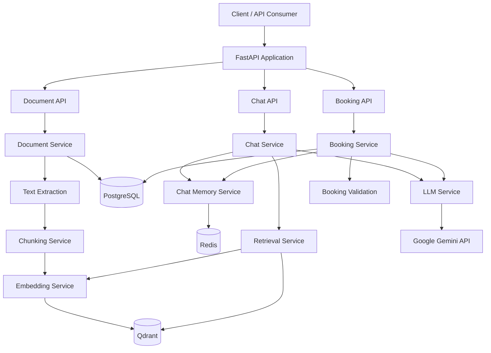
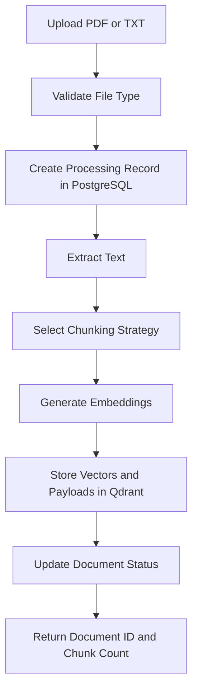
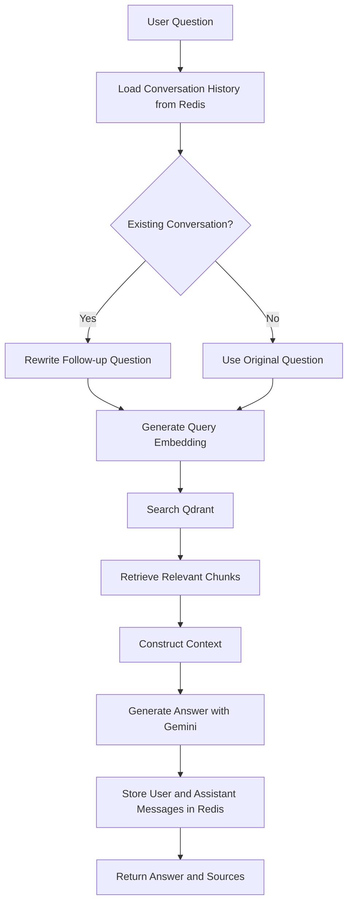
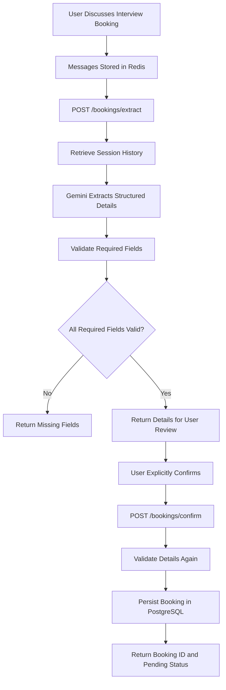

# VeriQuery — System Architecture

## 1. Architecture Overview

VeriQuery follows a modular backend architecture built around FastAPI. The application separates API routing, business logic, data validation, and infrastructure integrations.

The system consists of four major workflows:

1. Document ingestion and vector storage.
2. Semantic retrieval and conversational RAG.
3. Multi-turn conversation management.
4. AI-powered interview detail extraction and booking persistence.

### High-Level Architecture



---

## 2. Component Responsibilities

| Component | Responsibility |
|---|---|
| FastAPI Application | Application initialization and route registration |
| Document API | Handles document upload requests |
| Document Service | Coordinates document ingestion and storage |
| Extraction Service | Extracts text from PDF and TXT files |
| Chunking Service | Splits extracted text into manageable chunks |
| Embedding Service | Generates vector representations of text |
| Retrieval Service | Performs semantic similarity search |
| Chat Service | Coordinates conversational RAG processing |
| Chat Memory Service | Manages session history in Redis |
| LLM Service | Handles Gemini generation and query rewriting |
| Booking Service | Extracts and persists interview booking information |
| Booking Validation | Validates extracted booking fields |
| PostgreSQL | Stores relational metadata and booking records |
| Qdrant | Stores vectors and document chunk payloads |
| Redis | Stores short-lived conversation history |

---

## 3. Document Ingestion Pipeline

### Workflow



### Processing Steps

1. The client uploads a PDF or TXT file through `POST /documents/upload`.
2. The document service validates the file extension.
3. A document metadata record is created in PostgreSQL with `processing` status.
4. PyMuPDF extracts text from PDF files; TXT files are decoded as UTF-8.
5. Extracted text is divided into chunks.
6. Sentence Transformers generates embeddings for each chunk.
7. Each chunk and its metadata are stored in Qdrant.
8. The PostgreSQL document record is updated with the completed status and total chunk count.

### Chunking Strategies

**Fixed-size chunking**

- Splits text according to a configured character limit.
- Supports overlapping chunks.
- Helps preserve context across adjacent chunks.

**Paragraph-based chunking**

- Groups paragraphs while respecting the configured chunk size.
- Splits oversized paragraphs when necessary.
- Helps retain logical text boundaries.

### Embedding Model

The application uses:

`sentence-transformers/all-MiniLM-L6-v2`

- Embedding dimension: 384
- Runs locally using Sentence Transformers.
- Generates normalized embeddings for cosine similarity search.

### Qdrant Payload Structure

Each stored vector contains metadata similar to:

```json
{
  "document_id": 1,
  "filename": "sample.pdf",
  "chunk_index": 0,
  "text": "Extracted document content..."
}
```

The corresponding vector is stored alongside this payload.

---

## 4. Conversational RAG Pipeline

### Workflow



### Processing Steps

1. The client submits a question to `POST /chat/`.
2. The chat service loads recent messages associated with the session ID from Redis.
3. If previous conversation history exists, Gemini rewrites the question into a standalone retrieval query.
4. The embedding service converts the search query into a vector.
5. Qdrant retrieves the most relevant document chunks using similarity search.
6. An optional document ID filter restricts retrieval to a specific document.
7. Retrieved content is passed to Gemini as contextual information.
8. Gemini generates an answer grounded in the retrieved content.
9. User and assistant messages are stored in Redis.
10. The API returns the answer, session ID, search query, and retrieved source metadata.

### Retrieval Configuration

- Default retrieval limit: 5 chunks.
- Maximum allowed retrieval limit: 20.
- Similarity search uses cosine distance.
- Retrieval can optionally be filtered by document ID.

### Grounded Response Generation

The LLM service constructs a prompt containing:

- The user's question.
- Relevant retrieved document chunks.
- Conversation history when applicable.
- Instructions to avoid unsupported claims.

If no relevant chunks are retrieved, the system returns an insufficient-information response rather than inventing document-specific information.

---

## 5. Conversation Memory Architecture

Redis is used to maintain short-lived conversation history.

### Message Structure

```json
{
  "role": "user",
  "content": "What does the document say about machine learning?"
}
```

Assistant messages are stored using the same structure with the `assistant` role.

### Memory Management

- Each conversation is identified by a session UUID.
- Messages are stored in a Redis list.
- Only the most recent 20 messages are retained.
- Conversation history expires after 24 hours.
- The retrieval process uses recent conversation history to contextualize follow-up questions.

Redis keeps conversational state separate from permanent document and booking records.

---

## 6. Interview Booking Workflow

The booking workflow uses the conversation history to identify interview scheduling information.

### Workflow



### Extracted Fields

- Candidate name
- Email address
- Interview date
- Interview time
- Timezone

### Booking Safety and Persistence

The extraction and confirmation operations are intentionally separate.

**Extraction endpoint**

`POST /bookings/extract`

- Reads the user's conversation history.
- Uses Gemini to extract structured details.
- Validates required fields.
- Returns missing fields when information is incomplete.
- Does not save a booking.

**Confirmation endpoint**

`POST /bookings/confirm`

- Receives the reviewed booking details.
- Validates the details again.
- Saves the booking in PostgreSQL.
- Uses a unique session ID constraint and PostgreSQL upsert to prevent duplicate records for the same session.

A booking with `pending` status means the request has been stored. It does not indicate organizer approval or interview confirmation.

---

## 7. Database Design

The application uses three storage systems, each selected for a different purpose.

### PostgreSQL

Stores relational information:

**Documents**
- Document ID
- Filename
- File type
- Processing status
- Total chunks

**Bookings**
- Booking ID
- Session ID
- Candidate name
- Email
- Interview date
- Interview time
- Timezone
- Booking status
- Creation timestamp

A unique constraint on the booking session ID supports idempotent confirmation requests.

### Qdrant

Stores:
- Vector embeddings
- Document chunk text
- Document ID
- Filename
- Chunk index

Supports vector similarity search and metadata filtering.

### Redis

Stores:
- Session-based message history
- User and assistant messages
- Conversation expiration metadata

---

## 8. Error Handling and Reliability

The application validates input at multiple layers:

- Pydantic validates incoming API requests.
- Document services reject unsupported or empty documents.
- Chunking validates chunk size and overlap.
- Retrieval validates question content and top-k limits.
- Booking validation checks extracted candidate and schedule information.
- API routes map known service and infrastructure errors to appropriate HTTP responses.

### Known Reliability Limitations

PostgreSQL and Qdrant do not support a shared atomic transaction in this implementation.

The document ingestion service attempts compensating cleanup when certain failures occur. However, a process crash between vector insertion and relational database commit may leave orphaned vectors.

A future improvement would be an outbox-based workflow or scheduled reconciliation process.

---

## 9. Testing Architecture

Testing is divided into three categories.

### Unit Tests

Validate individual services and business logic:

- Document extraction
- Chunking strategies
- Document ingestion
- Retrieval logic
- Chat processing
- Redis memory operations
- Booking validation and persistence
- API behavior

### Integration Tests

Use actual infrastructure services:

- PostgreSQL
- Redis
- Qdrant
- Sentence Transformers

Gemini calls are mocked in deterministic integration workflows.

### Live Gemini Tests

Optional tests call the actual Gemini API to verify:

- Text generation
- Follow-up query rewriting
- Grounded answer generation

### Test Environment Isolation

Integration tests use dedicated resources:

- PostgreSQL test database: `palmind_test_db`
- Redis database: `1`
- Qdrant collection: `palmind_integration_test`

The integration fixtures reset these resources. They must never point to production or valuable development data.

---

## 10. Future Architectural Improvements

Potential improvements include:

1. Background document processing using a task queue.
2. Authentication and role-based access control.
3. Document deletion with coordinated vector cleanup.
4. Dependency-aware health and readiness checks.
5. Structured logging and distributed tracing.
6. Outbox-based consistency between PostgreSQL and Qdrant.
7. Improved prompt-injection protection.
8. Booking availability and scheduling conflict detection.
9. Interactive frontend integration.

---

## Summary

VeryQuery combines document processing, semantic retrieval, conversational AI, and structured information extraction in a modular backend architecture.

The separation of relational storage, vector search, and conversation memory allows each component to serve its intended purpose while keeping the application maintainable and testable.
